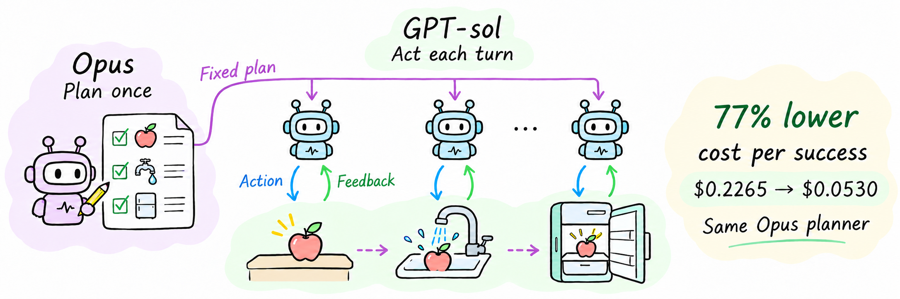
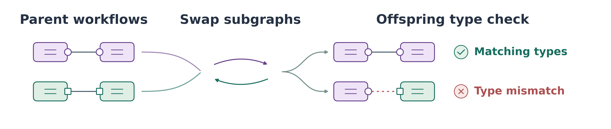

<h1 align="center">Agent Species</h1>

<strong>Planning Once, Acting Repeatedly</strong> 
Cross-model role exchange and interface compatibility in LLM agents

  
  
  
  
  

  

## Overview

A planner can work once per episode. The executor must act, observe the outcome, and decide again. That asymmetry makes the assignment of models to roles a practical choice about both capability and cost.

We cross four planner and executor endpoints in a shared [ALFWorld](https://alfworld.github.io/) harness. The planner supplies a strategy at reset, and the executor receives it together with recent action outcomes. Homogeneous pipelines and single-agent controls separate role assignment from the decision to use a two-stage scaffold. The [population study](#typed-population-study) tests which workflow interfaces allow offspring to execute after subgraph exchange.

## Results

All rows below are evaluated on the same **250 held-out ALFWorld tasks**. Cost includes failed attempts and is divided by the number of successes.

| Configuration | Tasks solved | Success | Cost per success |
|:--|--:|--:|--:|
| Single Opus | 216 / 250 | 86.4% | $0.2691 |
| **Opus planner → GPT-sol executor** | 228 / 250 | 91.2% | $0.0530 |
| GPT-sol planner → Opus executor | 232 / 250 | 92.8% | $0.2331 |
| Opus planner → Opus executor | **238 / 250** | **95.2%** | $0.2265 |
| GPT-sol planner → GPT-sol executor | 187 / 250 | 74.8% | **$0.0515** |

- **Where to spend inference.** Opus planning with GPT-sol execution solves 12 more tasks than single Opus at about one fifth of the cost per success. The all-Opus pipeline has the highest observed success.
- **Which role matters.** Across the common 135-task seen panel, the executor marginal means have a wider success range than the planner marginal means. A planner substitution can still make a substantial difference with a fixed executor.
- **Where the gain appears.** The all-Opus pipeline solves 52 of the 64 most expensive tasks for single Opus, compared with 30 for single Opus. Both solve all 186 remaining tasks.

The [16-cell matrix](data/matrix_cells/) contains the recorded task vectors. The [aggregate record](data/final_audit.json) contains the single-agent summary and cost-stratum counts. The [five evolutionary search snapshots](data/evo_runs/) use an eight-task development panel and are reported separately from the held-out results.

## Typed population study

In a separate experiment, agents exchange subgraphs of typed workflows. Matching ports pass a strict interface check. A mismatched edge blocks the offspring from executing.

  

## Reproduce

The released figures and results can be inspected without model access. The first command validates all matrix and search checksums, checks the recorded task totals, and prints the matched success–cost comparison. The other commands redraw the typed-crossover schematic, the role matrix, and the developmental search plots. The illustrated overview is included as a PNG.

~~~bash
git clone https://github.com/Hik289/Agent-species.git
cd Agent-species
python3 figure_code/audit_draft.py

python3 -m venv .venv
source .venv/bin/activate
python -m pip install matplotlib numpy
python figure_code/build_typed_crossover_figure.py
python figure_code/build_executor_matrix_figure.py
python figure_code/build_evo_convergence_figure.py
~~~

The [difficulty figure](figures/scaling_difficulty.png) is included as rendered. Regenerating it requires the matching 250-task single-Opus vector, supplied with the `--baseline` flag to `figure_code/build_difficulty_figure.py`. This archive contains the baseline aggregate rather than that per-task vector.

<strong>Live experiment requirements</strong>

The source includes the search, rollout, topology, and typed-crossover programs from the release archive. They preserve historical entry points and require the corresponding benchmark installations, dataset caches, and supporting adapters. Some imports, including `phase0`, `core`, and `niches`, refer to modules outside this archive. The offline workflow above runs with the released files alone.

For live use, configure your own model access and benchmark locations locally. [`.env.example`](.env.example) lists the environment variables with blank values. Model names in the logs are the endpoint identifiers used for those runs.

## Repository map

| Location | Contents |
|:--|:--|
| [`code/phase2/`](code/phase2/) | Role assignments, rollout harnesses, topology controls, and evolutionary search |
| [`code/`](code/) | Model client, typed crossover, and historical population and repair experiments |
| [`data/matrix_cells/`](data/matrix_cells/) | Sixteen role assignments with per-task outcomes, costs, and split labels |
| [`data/evo_runs/`](data/evo_runs/) | Five saved runs, generation-level traces, and release checksums |
| [`figure_code/`](figure_code/) | Data validation and figure generation |
| [`figures/`](figures/) | Research diagrams and rendered plots |

## License

Released under the [MIT License](LICENSE).
